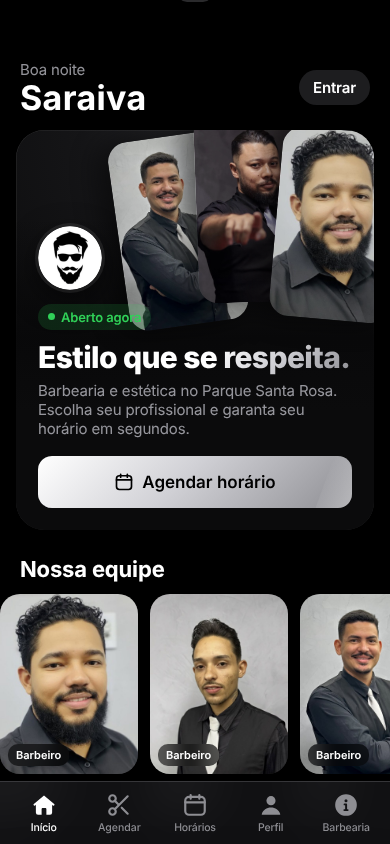
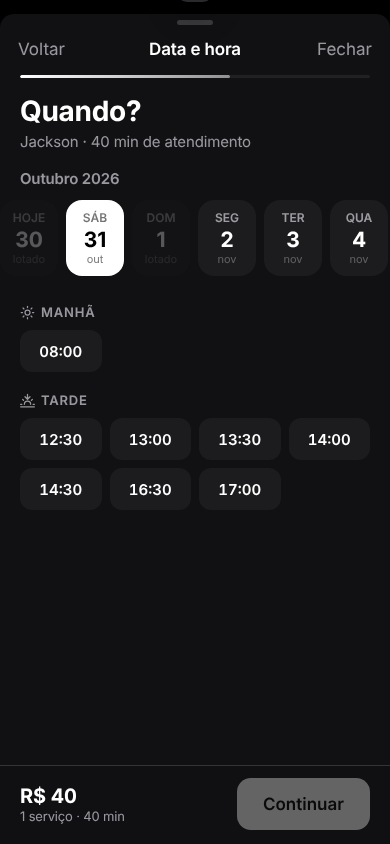
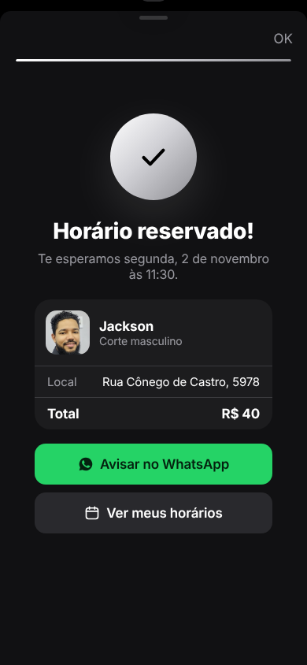
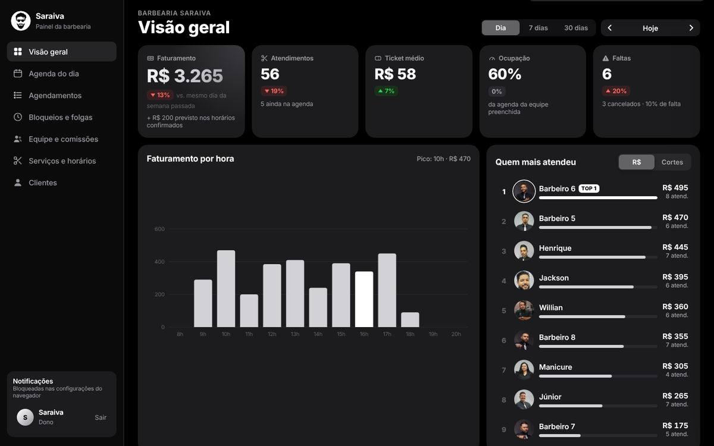
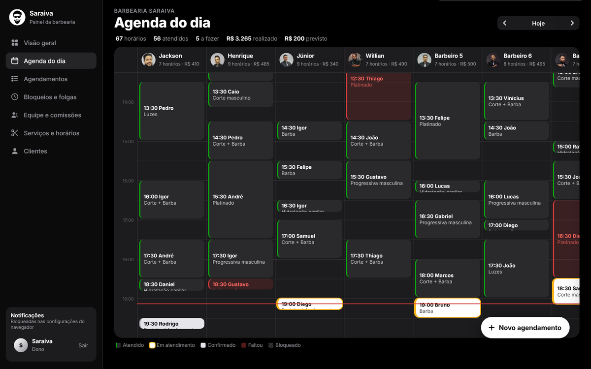

<div align="center">


# Barbearia Saraiva

**Agendamento online e gestão para a Barbearia Saraiva — Parque Santa Rosa, Fortaleza/CE**


</div>

---

São dois aplicativos num projeto só, os dois instaláveis no celular:

- **App do cliente:** o cliente escolhe o barbeiro, os serviços e um horário livre, e confirma em poucos toques.
- **Painel da barbearia:** o dono acompanha o faturamento e a equipe, e cada barbeiro cuida da própria agenda.

<div align="center">
  
  
  
  
</div>

## Funcionalidades

### Para o cliente
- **Login sem senha:** só nome e WhatsApp, confirmados por código SMS.
- **Agendamento em 4 passos:** profissional → serviços → dia e horário → confirmação.
  - Só aparecem horários que comportam a duração total dos serviços escolhidos.
  - O que é de unhas e estética fica com a manicure, o que é de barbearia fica com os barbeiros.
- **Meus horários:** próximos atendimentos, com opção de cancelar ou falar com a barbearia no WhatsApp.
- **Perfil:**
  - histórico de cortes, com botão de **repetir** o último serviço;
  - profissional favorito;
  - observação de "como gosto do meu corte", que já vai preenchida em cada agendamento.
- Localização, contato e horário de funcionamento.

### Para a barbearia
<div align="center">
  
</div>

- **Visão geral (por dia, 7 ou 30 dias):**
  - faturamento, atendimentos, ticket médio, ocupação da agenda e faltas, com comparação com o período anterior;
  - ranking da equipe;
  - serviços mais vendidos e recebimento por forma de pagamento.
- **Agenda do dia:** cada profissional numa coluna. Ela se atualiza em tempo real quando chega um agendamento novo.
- **Ações no atendimento:** marcar como atendido, falta ou cancelado, e registrar a forma de pagamento.
- **Encaixes:** lançar horários do balcão ou do WhatsApp, só em horários livres.
- **Bloqueios e folgas:** almoço, dia de folga ou a barbearia inteira (feriado).
- **Equipe e comissões:** comissão por profissional, valor a pagar no período e criação do login de cada barbeiro.
- **Serviços e horários:** preços, durações e horário de funcionamento editáveis pelo painel.
- **Clientes:** melhores clientes, novos clientes, clientes "sumidos" (com mensagem pronta pra chamar de volta) e clientes que mais faltam.
- **Notificação push** no celular do dono e do barbeiro a cada novo agendamento ou cancelamento.
- **Visão do barbeiro:** cada um vê só a própria agenda e os próprios ganhos.

<div align="center">
  
</div>

## Arquitetura

| Camada | Tecnologia |
|---|---|
| Front-end | Next.js 15 (App Router) + TypeScript, CSS próprio com visual inspirado no iOS |
| Back-end | Supabase: PostgreSQL, Auth (SMS e e-mail), Realtime |
| Regras de negócio | Funções SQL (RPC) e Row Level Security |
| Notificações | Web Push (VAPID) + Service Worker |
| Distribuição | PWA (cliente e painel com manifestos separados) |

### Decisões de projeto
- **Sem horário duplicado:** uma *exclusion constraint* (`btree_gist`) impede, no próprio banco, dois agendamentos sobrepostos para o mesmo profissional. Funciona mesmo quando dois clientes confirmam ao mesmo tempo.
- **Validação no servidor:** o agendamento passa pela função `book_appointment`, que confere:
  - a área do serviço e do profissional;
  - o horário de funcionamento;
  - os bloqueios.

  Ela também calcula preço e duração. O cliente nunca envia o valor.
- **Preço histórico:** cada agendamento guarda uma cópia do nome e do preço dos serviços. Mudar a tabela não altera o que já foi feito.
- **Permissões no banco (RLS):**
  - o cliente vê só os próprios horários;
  - o barbeiro vê e altera só a própria agenda;
  - o dono vê tudo;
  - depois de criado, um agendamento só pode ter status, forma de pagamento e observação alterados.
- **Métricas calculadas no Postgres:** as funções `dashboard` e `clients_report` devolvem os indicadores prontos para o painel.

### Modelo de dados
```
profiles ─────────┐
professionals ────┼──< appointments >── appointment_services >── services
time_blocks ──────┘
business_hours      push_subscriptions
```

## Estrutura
```
src/
├── app/
│   ├── (cliente)/        início, meus horários, perfil, a barbearia
│   ├── painel/           visão geral, agenda, agendamentos, bloqueios, equipe, serviços, clientes
│   └── api/              acessos da equipe, exclusão de conta, webhook de notificações
├── components/           app do cliente, painel, ícones
├── lib/                  clientes Supabase, tipos e formatação
└── styles/
supabase/
├── migrations/           esquema, segurança e funções
└── seed.sql              equipe, serviços e horário de funcionamento
public/
├── sw.js                 service worker
└── team/                 fotos da equipe
```

## Rodando localmente
```bash
npm install
cp .env.example .env.local   # preencher com as chaves do projeto Supabase
npm run dev
```
O app abre em `localhost:3000` e o painel em `localhost:3000/painel`.

---

<div align="center">

Desenvolvido por **[Leonardo Braz](https://github.com/Leonardobrzz)**

</div>
